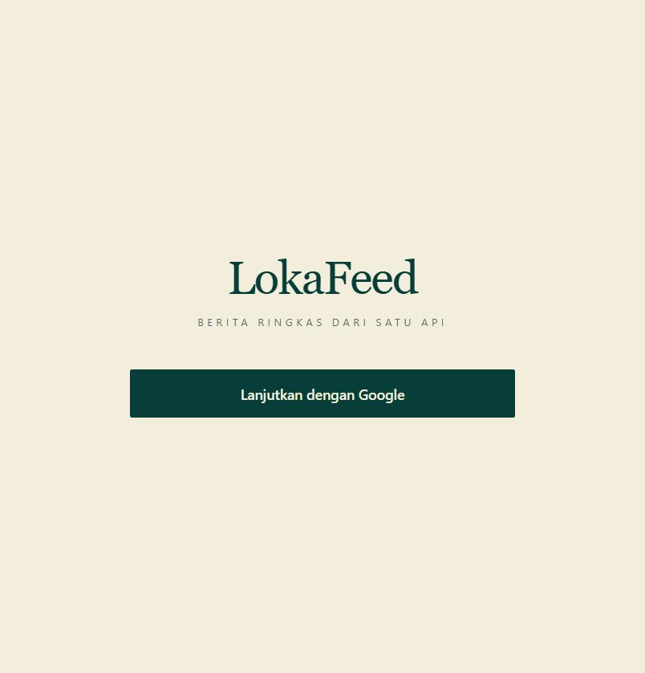

# LokaFeed

Portal berita berbasis Next.js Pages Router dengan fondasi layanan Go.

## Tangkapan layar


Beranda: berita ringkas, pencarian, dan kategori yang mengikuti sumber aktif.


Detail artikel: judul, waktu terbit, atribusi sumber, dan tautan ke artikel asli.



Masuk: satu tombol Google, tanpa formulir tambahan.

## Struktur

| Direktori | Isi |
|---|---|
| `apps/web` | Web dengan login Google dan pengambilan artikel melalui Go pada server |
| `apps/api` | Server Go berbasis pustaka standar; demo, RSS ANTARA, atau NewsAPI |

Alur berita: peramban → Next.js (periksa sesi) → Go → sumber aktif.
Mode bawaan memakai artikel contoh dari sumber `Contoh LokaFeed`, bukan berita aktual.

## Versi pengembangan

Node.js **22.16.0**, Go **1.24.0**, Next.js **15.3.4**, React **19.1.0**,
NextAuth **4.24.11**, Tailwind CSS **3.4.17**, PostCSS **8.5.6**,
Autoprefixer **10.4.21**, dan TypeScript **5.8.3**.

Versi dipin agar hasil build konsisten di semua mesin. Tinjau kerentanan
dan perbarui dependensi sebelum penggunaan produksi.

## Menjalankan web

Gunakan Node.js target pada terminal, lalu dari akar repositori:

```sh
npm ci
npm run dev
```

Buat `apps/web/.env.local` (jangan dikomit):

```dotenv
API_BASE_URL=http://127.0.0.1:8080
GOOGLE_CLIENT_ID=isi_client_id
GOOGLE_CLIENT_SECRET=isi_client_secret
NEXTAUTH_URL=http://localhost:3000
NEXTAUTH_SECRET=isi_rahasia_acak
```

Daftarkan callback Google:
`http://localhost:3000/api/auth/callback/google`.

Web tersedia di `http://localhost:3000`. Kredensial Google diperlukan untuk
masuk, termasuk ketika sumber berita memakai data demonstrasi. Daftar dan
detail memeriksa sesi pada server sebelum mengakses Go.

## Menjalankan API

Pada terminal terpisah dengan Go target:

```sh
cd apps/api
go run .
```

`GET http://127.0.0.1:8080/health` mengembalikan:

```json
{"status":"ok"}
```

Layanan hanya mendengarkan pada antarmuka lokal. Jalankan web dan Go pada
dua terminal yang berbeda. Go tidak otomatis membaca `.env.local`.

### Memilih sumber berita

| `NEWS_SOURCE` | Sumber | Kunci | Kategori |
|---|---|---|---|
| kosong atau `demo` | Contoh lokal | Tidak | Tujuh kategori contoh |
| `antara` | RSS resmi ANTARA | Tidak | Umum/Terkini, Ekonomi, Teknologi, Olahraga, Hiburan |
| `newsapi` | NewsAPI | `NEWS_API_KEY` | Tujuh kategori NewsAPI |

Satu sumber aktif per proses. Ubah konfigurasi lalu mulai ulang Go.
`GET /api/source` mengembalikan nama dan kategori sumber tanpa rahasia.
Web mengambil metadata tersebut pada server agar kategori mengikuti sumber.
Kategori yang tidak didukung menghasilkan 400 sebelum menghubungi penerbit.

### RSS ANTARA

Untuk pengujian lokal, dari `apps/api`:

```powershell
$env:NEWS_SOURCE = "antara"
go run .
```

Feed berasal dari [indeks RSS resmi](https://www.antaranews.com/rss).
Pencarian hanya mencakup judul/ringkasan yang tersedia pada feed kategori,
bukan seluruh arsip. Maksimal 100 artikel per respons; artikel disimpan
sementara untuk detail. `category` adalah label feed yang dipilih, bukan
klasifikasi per artikel dari penerbit.

Konten ditampilkan sebagai teks ringkasan, dengan atribusi `ANTARA News`
dan tautan asli, tanpa foto/logo atau pengambilan isi artikel penuh.
RSS publik **bukan izin bebas menerbitkan ulang**. Halaman RSS dan
[ketentuan umum ANTARA](https://www.antaranews.com/ketentuan-penggunaan)
memiliki batas penggunaan yang perlu diklarifikasi sebelum publikasi
atau penggunaan komersial. Integrasi ini ditujukan untuk pengujian lokal
pribadi sampai cakupan izin dipastikan.

### NewsAPI

Pada PowerShell terminal Go, atur variabel lingkungan untuk sesi tersebut:

```powershell
$env:NEWS_SOURCE = "newsapi"
$env:NEWS_API_KEY = "isi_kunci_anda_secara_lokal"
go run .
```

Jangan membagikan kunci atau menyimpannya dalam Git. `NEWS_API_KEY` hanya
dibutuhkan oleh Go, bukan oleh web. Untuk kembali ke demonstrasi:

```powershell
$env:NEWS_SOURCE = "demo"
go run .
```

Mode NewsAPI tanpa kunci dan nilai sumber tidak dikenal gagal saat startup;
kegagalan penyedia tidak otomatis diganti dengan sumber lain.

Mode NewsAPI mengambil maksimal 100 artikel pada halaman pertama. Pencarian
tanpa kategori memakai endpoint Everything; kategori memakai Top Headlines
dengan negara `us`, termasuk saat kata kunci juga diisi. Pencarian aktual
mengikuti semantik NewsAPI, sedangkan demo dan ANTARA mencari substring judul/ringkasan.

ID aktual berasal dari SHA256 URL sumber. Detail memakai `/article?id=<id>`
dan hanya tersedia untuk maksimal 500 artikel yang pernah dimuat; artikel tertua
dikeluarkan ketika kapasitas terlampaui, dan seluruh data hilang saat Go restart.
Tautan detail bukan tautan permanen. Setiap permintaan daftar aktual mengakses
penyedia; belum ada cache, pagination, atau retry otomatis. Perhatikan kuota akun.

Konten NewsAPI adalah cuplikan, bukan artikel penuh; baca sumber asli untuk
kelengkapannya. Kategori artikel aktual dikosongkan karena penyedia tidak
mengirim metadata tersebut. Tinjau ketentuan lisensi, atribusi, dan pembatasan
paket pengembangan NewsAPI sebelum penggunaan produksi.

### Menambah sumber pada fork

1. Tambahkan implementasi `articleSource` di `apps/api`: `info()` untuk
   identitas/kategori dan `fetch(ctx, query, category)` untuk artikel.
2. Normalisasikan hasil ke `Article`, gunakan ID stabil, batasi jaringan,
   dan jangan mengembalikan rahasia atau HTML aktif.
3. Daftarkan pilihan dalam `configuredStore`, validasi konfigurasi wajib,
   dan tambahkan pengujian sumber serta metadata.
4. Dokumentasikan batas pencarian, kategori, kuota, dan izin penerbit.

Web tidak perlu diubah jika kontrak artikel dan metadata tetap sama.
Mengganti URL saja tidak menjamin API lain kompatibel. Tidak ada sistem
plugin dinamis atau penggabungan banyak sumber pada tahap ini.

### Artikel demonstrasi

| Permintaan | Hasil |
|---|---|
| `GET /api/articles` | Daftar artikel contoh |
| `GET /api/articles?q=web&category=technology` | Pencarian judul/ringkasan dan kategori |
| `GET /api/articles/demo-technology` | Detail artikel contoh |

Daftar berbentuk `{"articles":[...]}` dan detail `{"article":{...}}`.
Pencarian demo tidak peka kapital, maksimal 200 karakter. Kategori demo:
`business`, `entertainment`, `general`, `health`, `science`, `sports`, `technology`.
Parameter tidak dikenal/berulang menghasilkan 400; ID tidak ditemukan menghasilkan
404. Data hanya disimpan dalam memori; belum ada penyimpanan permanen,
pagination, atau endpoint tulis.

## Pemeriksaan

Dari akar repositori:

```sh
npm run lint
npm run typecheck
npm test
npm run build
```

Dari `apps/api`:

```sh
go test ./...
go test -race ./...
go vet ./...
```

Pemeriksa race pada Windows memerlukan dukungan cgo dan compiler C yang sesuai.
Jangan memasang alat tambahan jika hanya ingin menjalankan pengujian biasa.

## Lisensi

ISC.

## Glosarium Istilah

- API: antarmuka layanan aplikasi.
- Callback: alamat penerima hasil otorisasi Google.
- Dependensi: paket perangkat lunak yang digunakan aplikasi.
- Commit: catatan perubahan pada Git.
- SSR: pembuatan halaman pada server.
- SHA256: fungsi sidik jari data untuk membentuk ID artikel.
- Cache: penyimpanan sementara hasil pengambilan data.
- Pagination: pembagian daftar ke beberapa halaman.
- Retry: pengulangan permintaan setelah gagal.
- RSS: umpan pembaruan artikel berbentuk XML.
- Adapter: penyesuai format sumber ke kontrak artikel aplikasi.
- Metadata: informasi sumber dan kategori yang didukung.
- Fork: salinan repositori untuk dikembangkan sendiri.
